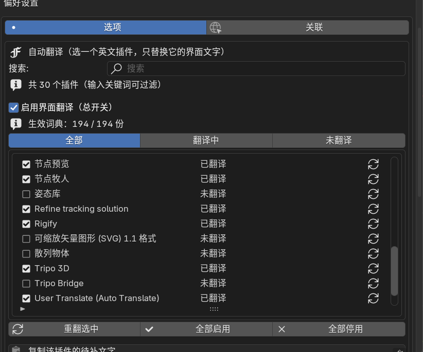

# User Translate (Auto Translate)

[](https://www.blender.org/)
[](CHANGELOG.md)
[](LICENSE)
[]()

把 Blender 第三方插件的英文界面变成中文——**只替换界面显示文字，不修改插件本身**，
勾上就翻译、取消就恢复原文。

> 本项目基于 [Bookyakuno](https://github.com/Bookyakuno) 的 *User Translate*（GPL-3）修改扩充，
> 沿用其词典加载机制，新增自动翻译、按插件开关、新装提示与性能优化。

> **命名说明**：项目名是 **User Translate (Auto Translate)**；
> 插件内部的模块目录仍叫 `user_translate`——这是 Blender 识别插件的身份，保持不变才能覆盖安装旧版，
> 并让用户已有的偏好设置和词典继续生效。



---

## 功能

- **按插件开关**：列出你安装的所有插件，每行一个勾选框
  - 勾上 = 该插件界面翻译成中文（没有词典时会自动生成）
  - 取消 = 恢复原文，其它插件不受影响
  - 行尾 `↻` = 重新翻译（插件更新后用）
- **搜索 + 筛选**：`全部 / 翻译中 / 未翻译`，列表自带滚动条
- **总开关**：一键停用全部翻译
- **新装插件提示**：检测到新插件时提示「要翻译吗？」，可一键全部翻译或忽略
- **190+ 份社区词典**，约 16.8 万条英文→中文对照，随包分发
- **未命中可补**：结果会显示「提取 N / 已翻译 M / 待补 K」，待补文字可一键复制
- **词典目录可外置**：把词典放到插件目录之外，覆盖更新插件时词典不会被覆盖
- **手工流程**：从 `.py` 提取字符串 → 外部翻译 → 粘回 → 生成词典（原版功能保留）

## 安装

1. 下载 [Releases](https://github.com/zzl0921/user-translate-auto/releases) 里的
   `user_translate_auto-x.y.z.zip`（或把本仓库的 `user_translate/` 文件夹压成 zip）；
2. Blender → `编辑 → 偏好设置 → 插件`；
3. 右上角下拉箭头 → **从磁盘安装**，选择该 zip；
4. 勾选启用 **User Translate (Auto Translate)**；
5. 展开偏好设置 → 勾选「界面翻译」→ 语言选「简体中文」。

> 若之前装过原版 User Translate，请先卸载旧版：两者模块名相同，会互相覆盖。

## 使用

1. 在「搜索」框输入关键词缩小范围（例如 `node`）；
2. 在列表里勾选要翻译的插件 —— 立即生效，无需重启；
3. 取消勾选即恢复英文；
4. 插件升级后，点该行右侧 `↻` 重新生成词典。

常用选项：

| 选项 | 作用 |
|---|---|
| 启用界面翻译（总开关） | 关闭后所有词典失效 |
| 覆盖已有 CSV | 重建词典时覆盖旧文件（自动备份 `.bak`） |
| 新装插件时提示 | 检测到新插件时在面板顶部提醒 |
| 注册全部上下文（慢） | 默认只注册 `*` 上下文；个别文字没翻译时打开 |
| 词典目录 | 留空=插件自带 `user_files`；可指向外部文件夹 |

## 工作原理

1. 用正则从插件源码中提取 `bl_label` / `bl_description` / `bl_category` / `description` / `name` / `text`；
2. 在随包词典里查找对应中文；
3. 生成 `user_files/<模块名>.csv`（两列：`"中文","English"`）；
4. 通过 `bpy.app.translations.register()` 注册，Blender 绘制界面时自动替换。

插件代码、数据、逻辑完全不改动；停用插件即恢复原文。

## 性能

| 指标 | 优化前 | 当前 |
|---|---|---|
| 启动注册耗时 | ~5.7 s | **~0.8 s** |
| 注册词条数 | 1090 万（词条 × 55 上下文） | **约 18 万**（唯一词条 × `*`） |

优化手段：跨词典去重 + 只注册界面实际查询的 `*` 上下文（可用开关恢复全量）。

## 目录结构

```
user_translate/
├── __init__.py          # 插件入口、偏好设置与面板
├── translation.py       # 词典目录、注册/注销、上下文选择
├── auto_translate.py    # 插件枚举、字符串提取、词典合并与翻译
├── op_auto.py           # 自动翻译操作器、插件列表（UIList）与菜单
├── op_other.py          # 原版：提取文本 / 剪贴板 / 合并
├── utils.py             # 偏好访问、编码容错读取
└── user_files/*.csv     # 词典（每插件一份）
```

## 常见问题

- **勾选后有几条没变**：词典里没有这几条，属正常；用「复制该插件的待补文字」导出后补。
- **某插件变成奇怪的中文**：它的词典列错位（社区词典通病），勾「覆盖已有 CSV」+ `↻` 重建。
- **第一次勾选要等几秒**：正在为该插件生成词典；之后启用/停用是秒开的。
- **和目标语言不对**：把偏好设置里的「语言」改成你需要的语言。

## 贡献

- 词典是 `user_files/*.csv`，格式 `"中文","English"`（UTF-8）；
- 欢迎提 PR 补充词典或修复译文；新增词典请用插件模块名命名，便于自动匹配；
- 发现 bug 请附上 Blender 版本、插件名和复现步骤。

## 致谢与许可

- 原项目：[User Translate](https://github.com/Bookyakuno) by **Bookyakuno**
- 本版维护：**zzl0921**
- 许可：[GNU GPL v3](LICENSE)。原作者的署名与许可声明保留，本版为修改版本。

修改记录见 [CHANGELOG.md](CHANGELOG.md)。
